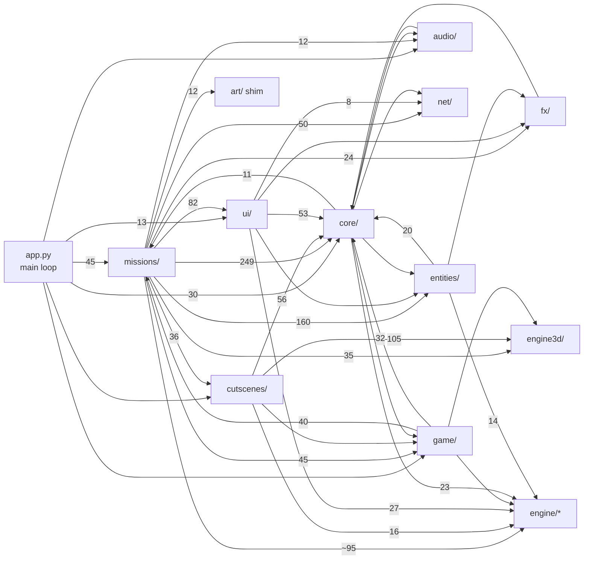
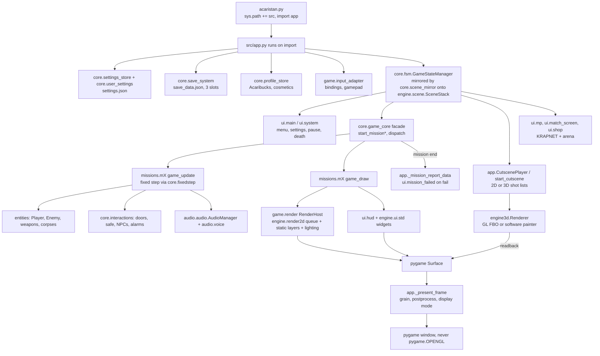
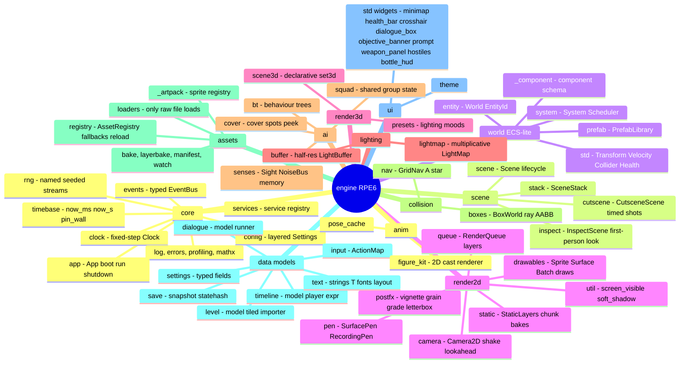
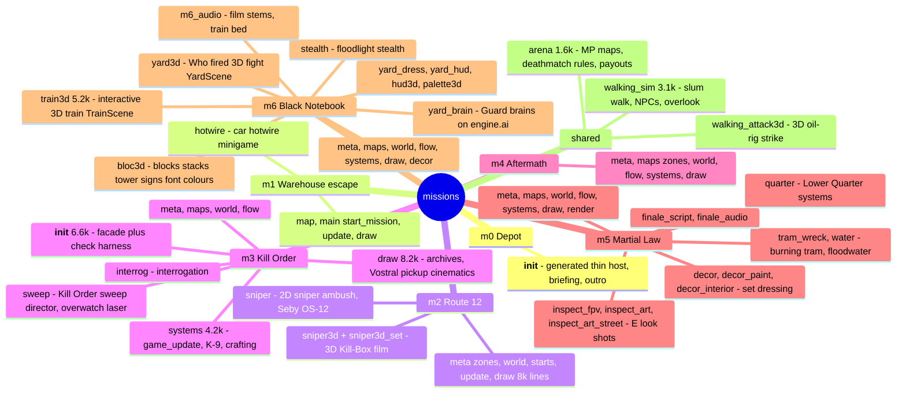
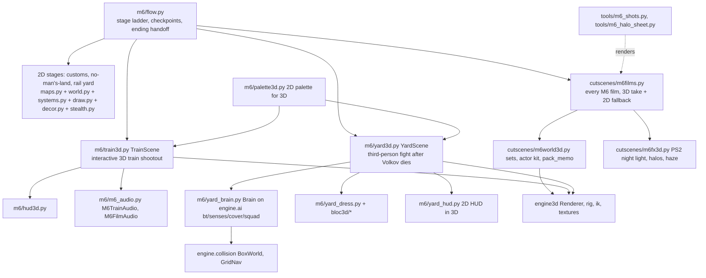
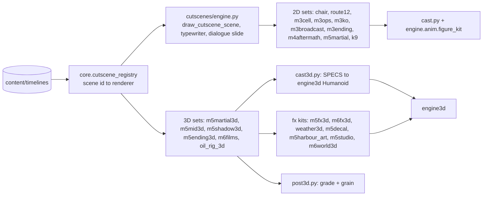
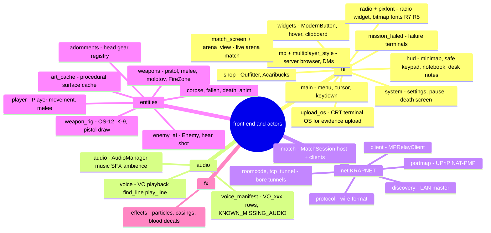
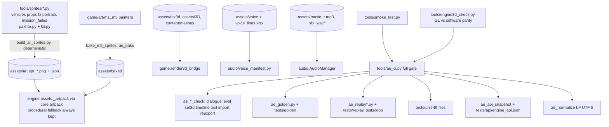

# Call of Acaristan - project mind map

Top-down action game (Python >=3.13, `pygame-ce`, `numpy`, `moderngl`) on the in-house **RPE6** engine. It has 2D missions M0-M6, a GL/software low-poly 3D renderer for films and the M6 3D fights, and KRAPNET multiplayer.

- Run: `python acaristan.py`
- Gates: `python tools/smoke_test.py` (`SMOKE TEST: OK`), `python -m compileall -q src`, `python tools/ae_ci.py` (`AE CI: OK`)
- Rules: `AGENTS.md`. Engine plan of record: `docs/engine/STATUS.md`. Session handoff: `.wolf/STATUS.md`.

Size map (lines): missions/m3 26.5k, cutscenes 21.7k, ui 18.5k, missions/m2 15.0k, missions/m6 13.3k, missions/m5 7.5k, core 6.9k, entities 5.0k, app.py 4.4k, audio 4.3k, engine3d 3.5k, net 3.4k. The whole `engine/` package is about 9k.

---

## 1. Package dependency graph

Edges come from real imports. The number is the import count, which shows how tightly packages couple.

Reading it:
- `core/` is the hub. Almost everything reads `core.state.STATE` and `core.config`.
- `missions/` is the heaviest consumer: it pulls entities, UI widgets, net (the arena) and game adapters.
- `cutscenes/` is mainly a client of `engine3d/`, with 105 imports.
- The `game` and `missions` packages, and `core` and `missions`, import each other. Those links are lazy, function-level imports (`# lazy:`), so they don't form cycles at load time.
- `engine/*` never imports the game. It is the clean layer.

---

## 2. Boot and frame flow

---

## 3. RPE6 engine (`src/engine/`)

---

## 4. Game glue (`src/game/`), core services (`src/core/`), 3D renderer (`src/engine3d/`)

```mermaid
graph TD
  subgraph game["game/ - engine-to-content adapters"]
    GR["render/ RenderHost, adapters"]
    GW["world/ World + Scheduler<br/>legacy.py strangler views"]
    GB["render3d_bridge<br/>set3d, mesh, texture loading"]
    GS["save_adapter capture restore statehash"]
    GD["dialogues / timelines / levels<br/>use_legacy switch"]
    GI["input_adapter"]
    GDEV["devtools in-game debug"]
    GA["art/m1..m5 procedural sprite painters"]
    GC[("content/ JSON data")]
  end
  subgraph core["core/ - shared game services"]
    ST["state.STATE singleton"]
    CFG["config colours, HEIGHT, grain, skyline painters"]
    GCORE["game_core mission start facade"]
    MB["mapbuilder MapBuilder, no deps"]
    CAM["camera follow, lookahead, bullets"]
    INTR["interactions doors safe NPCs"]
    APPR["appearance + outfits + profile_store"]
    SAVES["save_system settings_store json_store"]
    FIX["fixedstep FixedStepClock"]
    MISC["ambience surfaces props hands staticlayer console dev_jumps mission_meta cutscene_registry"]
  end
  subgraph e3d["engine3d/"]
    R["Renderer picks GL or software"]
    GL["gl.py GLRenderer ModernGL FBO"]
    SW["core.py math meshes camera SoftwareRenderer"]
    RIG["rig.py Humanoid boxes on joints, poses"]
    IK["ik.py two-bone arm leg rifle hold"]
    TX["textures.py pixel textures, glitter"]
  end
  GD --> GC
  GB --> GC
  GB --> R
  R --> GL
  R --> SW
  RIG --> R
  IK --> RIG
  TX --> R
  GW --> ST
  GCORE --> ST
```

Content data (`src/game/content/`):
- `levels/*.level.json` - m1 warehouse, m2 city, m3 archives/broadcast/cell/comms/kill_order, m4 station/street, m5 hq/print/quarter.
- `timelines/*.timeline.json` - cutscene shot lists (core, m2, m3, ...).
- `dialogue/*.dlg.json` - m4 liaison, m5 maru, mission0 briefing.
- `sets/*.set3d.json`, `meshes/*.mesh.json`, `textures/*.texture.json`, `lighting3d/*.preset.json`, `grades/*.grade.json`.
- `strings/en.json` - every UI/caption string, looked up with `engine.text.T()`.
- `m1..m5/manifest.json` - art pack manifests; `m5/palette.json`.

---

## 5. Missions (`src/missions/`)

Each mission is a package whose `__init__.py` is a re-export facade; facade order is load order. Common parts: `meta` (constants and timelines), `maps` (MapBuilder to `list[str]`), `world` (spawns, NPCs), `flow` (start and checkpoints), `systems`/`update` (per-frame), `draw` (renderer), `components` (ECS roles).

### M6 detail (current branch `m6/train-polish`)

---

## 6. Cutscenes (`src/cutscenes/`)

The cast look is defined once in `figure_kit.SPECS`. The 2D cutscenes, the 3D rigs (`cast3d`) and the radio portraits (`tools/sprites/portraits.py`) all derive from it.

---

## 7. UI, audio, net, entities

---

## 8. Asset and verification pipeline

---

## Where to find X

| Need | Go to |
|---|---|
| Main loop, state transitions, cutscene start | `src/app.py` (`trigger_transition`, `start_cutscene`, `_present_frame`) |
| Global game state | `src/core/state.py` (`STATE`) |
| Colours, screen size, sky/building painters | `src/core/config.py` |
| Start a mission or checkpoint | `src/core/game_core.py`, then `missions/mX/flow.py` or `starts.py`/`main.py` |
| Dev jump targets (`--dev-mission6-shootout` and others) | `src/core/dev_jumps.py` |
| Mission name, radio channel, fail text | `src/core/mission_meta.py`, `missions/mX/meta.py` |
| Map layout | `missions/mX/map.py` or `maps.py` (MapBuilder), `content/levels/*.level.json` |
| Enemy behaviour (2D) | `src/entities/enemy_ai.py`; M3 sweep `missions/m3/sweep.py` |
| Enemy brains (3D yard) | `missions/m6/yard_brain.py` on `engine/ai/` |
| Player movement and weapons | `entities/player.py`, `entities/weapons.py`, `entities/weapon_rig.py` |
| Doors, safe, NPC interactions | `src/core/interactions.py` |
| HUD | `ui/hud.py`, `engine/ui/std/*`; 3D HUDs `missions/m6/hud3d.py`, `yard_hud.py` |
| Menus, settings, pause | `ui/main.py`, `ui/system.py` |
| Radio calls | `ui/radio.py`, `ui/pixfont.py` |
| Any UI string or caption | `src/game/content/strings/en.json` |
| Voice line ids | `src/audio/voice_manifest.py`; playback `audio/voice.py` |
| Music, SFX, ambience | `audio/audio.py`, `core/ambience.py`, `core/surfaces.py` (footsteps) |
| Mission-specific audio | `missions/m5/finale_audio.py`, `missions/m6/m6_audio.py` |
| 3D renderer API | `engine3d/core.py` (software + math), `engine3d/gl.py` (GL) |
| 3D characters and poses | `engine3d/rig.py`, `engine3d/ik.py`, `cutscenes/cast3d.py` |
| 2D character look | `engine/anim/figure_kit.py` (`SPECS`), `cutscenes/cast.py` |
| A cutscene's shots | `content/timelines/*.timeline.json`, or the `meta.py` timelines of M5/M6 |
| A cutscene's drawing | `cutscenes/<mission file>.py` (see section 6) |
| Post grade and grain | `cutscenes/post3d.py`, `engine/render2d/postfx.py`, `content/grades/` |
| Sprites | `tools/sprites/*` generate them, `assets/art/` holds them, `core.artpack` reads them |
| Saves | `core/save_system.py`, `core/json_store.py`, `game/save_adapter.py` |
| Settings | `core/settings_store.py`, `core/user_settings.py`, `engine/settings/` |
| Key bindings | `game/input_adapter.py`, `engine/input/model.py` |
| Multiplayer | `net/*`, `ui/mp.py`, `ui/match_screen.py`, `ui/arena_view.py`, `missions/arena.py` |
| Collision and pathing | `engine/collision/boxes.py`, `engine/collision/nav.py` (roadmap 6.9) |
| Engine design and bugs | `docs/engine/ARCHITECTURE.md`, `STATUS.md`, `BUGS.md`, `ADAPTERS.md`, `adr/` |
| Story canon | `docs/LORE.md`, `docs/MISSION*_PLOT.md`, `docs/FIXES_STORIES.md` |
| History | `docs/worklog.md`, `docs/engine/CHANGELOG.md` |
| Shot evidence and renders | `shots/`, `tools/m5_shots.py`, `tools/m6_shots.py` |

---

## Key directories

- `src/` - all game code (section 1). It is added to `sys.path` by the launcher.
- `assets/` - runtime media: `art/` generated sheets, `baked/` layers, `tex3d/` and `3D/` textures and meshes, `music/`, `voice/`, `fonts/`, `sprites/`.
- `tools/` - gates (`smoke_test.py`, `ae_ci.py`, `ae_*`), sprite generators (`sprites/`), mission shot and probe scripts (`m5_*`, `m6_*`), trailer renderers, MP host/join bots, build scripts (`build_windows.py`, `build_*_exe.bat`).
- `tests/` - `unit/` (49 test files), `golden/` and `replay/`/`loop/` baselines, `api/engine_api.json` snapshot, `data/` scene traces.
- `docs/` - lore, mission plots and plans, audits (`AUDIT_T1..T8`), `worklog.md`, and `engine/` (architecture, ADRs, bugs, status).
- `shots/`, `_shots/`, `previews/`, `outputs/`, `trailers/`, `validation/` - generated evidence and renders. They are not code.
- `archive/`, `handoff/`, `SKILLS/`, `apollo-agent/` - old material and agent tooling.
- `.wolf/` - OpenWolf: `STATUS.md` handoff, `anatomy.md` file index, `buglog.json`, `cerebrum.md`.

## Critical files

- Entry: `acaristan.py`, `src/app.py`
- State and flow: `src/core/state.py`, `src/core/fsm.py`, `src/core/scene_mirror.py`, `src/engine/scene/stack.py`, `src/core/game_core.py`
- Time: `src/engine/core/timebase.py`, `src/core/fixedstep.py`
- Maps: `src/core/mapbuilder.py`
- Render: `src/game/render/host.py`, `src/engine/render2d/queue.py`, `src/engine3d/gl.py`, `src/engine3d/core.py`
- Data: `src/game/content/strings/en.json`, `src/audio/voice_manifest.py`
- Config and build: `pyproject.toml`, `Call of Acaristan.spec`, `build.bat`, `.gitattributes`
- Rules: `AGENTS.md`, `CLAUDE.md`, `docs/engine/STATUS.md`

## Architectural patterns

- **Facade packages.** Package `__init__.py` files re-export their part modules, and facade order is load order. Parts import only earlier parts at top level; later ones go in lazy `# lazy:` imports.
- **Single-owner mutable globals.** Read them as `import owner as _o; _o.name`, never `from owner import name`. Facades expose them as PEP 562 live views.
- **Strangler migration to RPE6.** Legacy objects are mirrored into the engine (`core/scene_mirror.py`, `game/world/legacy.py`, `game/*` `use_legacy` switches). Deprecated `core.artpack`, `core.lighting` and `entities.sprite_lib` paths forward into `engine.*`.
- **Game time only.** Use `engine.core.now_ms()/now_s()`. Never call `pygame.time.get_ticks()` or `time.time()` in gameplay or draw code.
- **Maps stay `list[str]`.** Structure and spawns are authored separately and baked; collision, minimap, camera and A* depend on that format.
- **3D on a 2D window.** `engine3d` draws off-screen and the frame is read back onto the pygame Surface. GL falls back to software (`ACARISTAN_RENDERER=gl|software`).
- **Code-generated deterministic art.** Sprites come from seeded generators and are read through `core.artpack`, always with a procedural fallback.
- **Data-driven content.** Levels, timelines, dialogue, 3D sets, presets and strings are JSON under `game/content`, validated by `tools/ae_*_check.py`.
- **Voice lines.** A new line needs a `VO_xxx` row plus a `KNOWN_MISSING_AUDIO` entry, never a `VOICE_ORDER` entry. Never edit a line that already has a recorded take.

Hot spots to read with ranges, not whole: `missions/m3/draw.py` (8.2k lines), `missions/m2/draw.py` (8.0k), `missions/m3/__init__.py` (6.7k), `missions/m6/train3d.py` (5.2k), `app.py` (4.4k), `missions/m3/systems.py` (4.2k), `ui/match_screen.py` (3.7k), `ui/mp.py` (3.4k), `audio/audio.py` (3.2k), `missions/walking_sim.py` (3.1k), `ui/upload_os.py` (3.1k).
